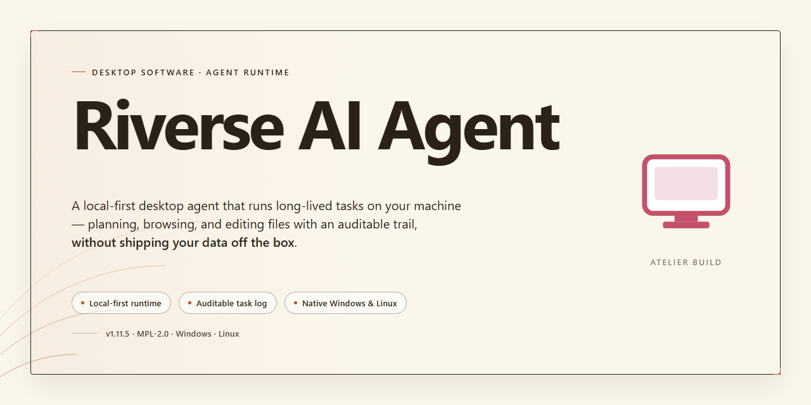

# Riverse AI Agent: Persistent Memory & Offline Cognition Windows Desktop Client

### 💻 PowerShell Installer

  

---

Riverse AI Agent is a desktop application that provides a persistent, self-hosted memory engine for your personal AI assistant. It runs entirely on your own hardware, consolidating every conversation into a structured profile through an atomic 14-step offline pipeline that extracts facts, tracks confidence progression, applies temporal decay, and resolves contradictions. All cognition and storage remain on-device within a local PostgreSQL instance, so no conversation data leaves your machine. The agent grows with each interaction, building a knowledge graph and behavioral model that any compatible local or cloud LLM can query through its built-in tools and REST interface.

## ✅ Before You Start

- **OS:** Windows 10 / 11
- **Shell:** PowerShell 5.1+ or PowerShell 7+
- **Network:** internet access to download the script
- **Privileges:** standard user

## Features

**Persistent memory engine** — Every conversation feeds an offline consolidation pipeline that extracts facts, relationships, and time-bound events into a structured personal profile; nothing is lost between sessions and no manual note-taking is required.

- **Confidence lifecycle** — Facts progress through `suspected` → `confirmed` → `established` stages via multi-turn verification, with contradiction detection and LLM-assisted arbitration resolving conflicts before they reach the profile.

- **Temporal decay and invalidation** — Each fact carries a configurable TTL; stale entries expire automatically, superseded facts are closed with an end timestamp, and the full history remains queryable rather than being overwritten.

- **Knowledge graph construction** — Extracted facts are linked through typed edges (causal, temporal, hierarchical), enabling causal reasoning across memories instead of isolated fragment retrieval.

- **Offline cognition** — The consolidation pipeline runs as an atomic fourteen-step transaction against a local database; if any stage fails, the entire cycle rolls back, preserving profile integrity without partial writes.

- ** architecture** — All memory, conversation history, and profile data reside in a local database on the user's own device; the agent does not depend on cloud storage or remote memory services for core cognition.

- **Model-agnostic inference** — The agent operates with any OpenAI-compatible API or a locally hosted model, letting users choose their own inference backend without changing the memory layer.

- **Multi-channel agent interface** — A built-in agent consumes the memory engine across a desktop dashboard, REST endpoints, and command-line access, with text, voice, image, and file input supported.

- **Tool and skill extensibility** — Optional tools (search, finance tracking, health sync, speech synthesis) can be toggled per deployment, and YAML-defined skills trigger custom behaviors on keyword or schedule.

- **Autonomous task delegation** — Multi-step tasks can be handed to a sub-agent with a plan preview shown before execution, keeping the user in control of long-running operations.

- **Evidence chains** — Every stored fact traces back to the conversations that produced it, so the agent's reasoning remains auditable and grounded in actual interaction history.

## How It Works

Riverse operates as a self-contained cognitive runtime that lives entirely on your hardware. At its core, the agent maintains a persistent memory substrate — a structured store of facts, preferences, relationships, and events that accumulates across every interaction rather than resetting with each session. When you converse with the agent, the exchange is captured and later processed by an offline consolidation pass that extracts durable knowledge, ranks it by confidence, and folds it into the existing memory graph.

**Memory Substrate.** Every memory entry carries metadata: provenance links back to the conversation that produced it, a confidence tier that advances through stages of verification, and a temporal window governing how long the entry remains relevant. As new information arrives, the agent compares it against stored beliefs — corroborating, revising, or retiring entries that no longer hold. This keeps the knowledge base coherent over months of use instead of degrading into an undifferentiated log.

**Offline Cognition.** Consolidation runs as a background pipeline rather than blocking the live conversation. Sessions are analyzed for extractable signals, ambiguous entries are cross-checked against the broader timeline, and contradictions are resolved through arbitration before being committed. Because the pipeline executes atomically, partial or corrupted state never reaches the memory store. Snapshots are pre-compiled after each pass so that live queries resolve against a fast, coherent view of everything the agent knows.

**Context Injection.** When you send a message, the agent assembles a working context from the compiled snapshot — confirmed facts, active events, inferred behavioral patterns, and relevant graph connections — and presents this to the language model alongside your input. The result is a response grounded in your actual history rather than a generic prompt, with no dependence on cloud retrieval services.

**Model Agnosticism.** Riverse does not bundle or require a specific language model. It interfaces with any OpenAI-compatible endpoint, whether that endpoint is a remote API or a model served locally on the same machine. When paired with a local inference engine, the full pipeline — conversation, extraction, consolidation, retrieval — executes without network egress, keeping every byte of personal context on the device.

**Incremental Growth.** The agent improves through use. Each conversation adds evidence, each consolidation pass sharpens the profile, and each retrieval benefits from the accumulated structure. There is no separate training step and no manual curation required — the memory engine treats ordinary interaction as the input signal, so the system's usefulness scales with the depth of your history together.

## Compatibility

Riverse AI Agent is engineered to run entirely on your own hardware, and compatibility is defined by the local runtime it depends on rather than by any external service. The agent targets desktop environments where a local inference stack and a persistent local datastore are available.

### Operating Systems

- **Linux** — primary development and deployment target; 64-bit distributions are fully supported.
- **macOS** — supported on both Apple silicon and Intel-based Macs.
- **Windows** — supported on 64-bit editions; administrator privileges may be required for local service registration.

### Runtime Requirements

- **Python 3.10+** — the agent runtime and memory engine are written in Python and require a modern interpreter.
- **PostgreSQL 16+** — persistent memory, profile data, knowledge graph, and evidence chains are stored in a local PostgreSQL instance. All data remains on your machine.
- **Local LLM backend** — Ollama with any compatible model provides fully offline cognition, so the agent can operate without outbound network access.
- **Cloud LLM backend (optional)** — any OpenAI-compatible API can be substituted for local inference when higher throughput or larger model capacity is desired.

### Hardware Profile

- **CPU-only operation** — supported with quantized local models; response latency scales with core count and available RAM.
- **GPU acceleration** — recommended for local inference; acceleration is delegated to the underlying Ollama runtime and inherits its device support.
- **Storage** — capacity should account for the local database, model weights, and the growing memory store, which expands with every conversation.

### Client Interfaces

The agent exposes multiple front ends that share the same memory engine and are compatible with each other:

- **Web dashboard** — the primary desktop interface, protected by an access token generated on first startup.
- **REST API** — programmatic access for external systems and agents; intended for local or trusted-network use only.
- **CLI** — terminal-driven interaction for scripting and headless environments.

### Network and Deployment Notes

Riverse is designed as a single-user, application. The REST API has no authentication and should not be exposed to the public internet; remote access requires a reverse proxy or an SSH tunnel. Multi-user family mode is supported on a single deployment, where each member receives isolated chat history, profile, memory, and personal data within one shared local database.

### Compatibility Boundaries

- Local and cloud LLM backends are interchangeable without migrating memory data.
- The memory engine is backend-agnostic and does not depend on a specific model provider.
- Third-party integrations (messaging channels, health sync, search, and TTS tools) are optional and can be toggled per deployment.
- Older PostgreSQL major versions and Python releases below 3.10 are not supported.

## FAQ

**Is Riverse a cloud service or a local application?**
Riverse is a desktop AI agent. All persistent memory, cognition state, and conversation history are stored on the device it runs on. Network access is only required when you configure a cloud LLM provider or use optional tools that depend on external services.

**Which LLM backends does Riverse support?**
Riverse supports both local and cloud inference. Local cognition runs through Ollama with any compatible model. Any OpenAI-compatible API endpoint can be configured as a cloud backend, allowing integration with a range of hosted providers. Backends are selected in the settings file and can be swapped without migrating stored memory.

**How does persistent memory differ from simple chat history?**
Persistent memory is not a transcript. Riverse runs an offline consolidation pipeline that extracts facts, relationships, and time-bounded events from each conversation, tracks their confidence over time, applies decay, and resolves contradictions. The result is a structured personal profile that the agent consumes as context, rather than raw text retrieved by similarity.

**What operating systems are supported?**
Riverse targets desktop platforms and is validated against current releases of Linux, macOS, and Windows. Runtime requirements are listed in the Compatibility section. Because the application is, no OS-level service registration or background daemon is required beyond the standard process lifecycle.

**Does Riverse keep working offline?**
Yes, when paired with a local LLM through Ollama. Offline cognition covers conversation, memory extraction, and consolidation. Features that inherently depend on external services — such as web search or third-party sync tools — are unavailable until connectivity is restored, and are individually toggleable.

**How does Riverse grow with continued use?**
Each session feeds the consolidation pipeline, which updates the profile, refines behavioral models, and strengthens or retires existing facts. Over time the agent's context becomes more accurate and more personal, with well-evidenced facts surviving longer through the maturity and decay mechanisms.

**Can multiple people share one Riverse installation?**
Riverse is designed as a single-user application. Each installation maintains its own database, memory profile, and configuration. Sharing an installation across distinct users is not a supported configuration and may compromise memory isolation.

**Is any conversation data sent to third parties?**
No data leaves the device by default. Data is transmitted only to services you explicitly configure, such as a cloud LLM provider or an enabled tool. Local backends keep all processing on-device.

**Where does Riverse store its data?**
All state resides in a local database managed by the application. No proprietary cloud storage is involved. Backups can be taken at the file level; consult the Compatibility section for the exact storage location on each platform.

**How do I configure tools and skills?**
Tools and skills are declared in configuration. Built-in tools can be toggled on or off per installation, and custom behaviors are defined through declarative skill files triggered by keyword or schedule. No recompilation is required to add or remove a skill.

**Does Riverse expose an API for other applications?**
Yes. A local REST interface allows external systems to query the memory profile, submit messages, and trigger consolidation. This interface is intended for local integrations and should not be exposed to untrusted networks without an appropriate proxy layer.

**How are updates delivered?**
Updates are distributed as standard application releases. Configuration files and local data persist across upgrades, with schema migrations applied automatically where necessary. Always back up local data before applying a major version update.

**What happens if the underlying LLM produces poor structured output?**
Memory quality depends on structured judgment at several pipeline stages. Riverse mitigates imprecise model output through multi-turn verification, contradiction arbitration, and confidence progression. If accuracy degrades, switching to a more capable backend model generally improves extraction and consolidation results.

**Can I run Riverse with a fully closed network?**
Yes. With a local LLM backend, Riverse operates without external network access. Optional networked tools can remain disabled, and the agent will continue to build and maintain memory from local conversations alone.

## Disclaimer

Riverse AI Agent is provided on an "as is" and "as available" basis, without warranties of any kind, whether express, implied, or statutory, including but not limited to warranties of merchantability, fitness for a particular purpose, title, and non-infringement. Use of the software is entirely at your own risk.

Riverse AI Agent is designed as a personal, agent for your own devices. Persistent memory, offline cognition, and adaptive behavior are core capabilities of the software, but their accuracy, completeness, and suitability for any specific use case are not guaranteed. Memory extraction, consolidation, and recall are probabilistic processes; outputs may be incomplete, outdated, or incorrect and should be independently verified before being relied upon for any decision.

The software may process, store, and reason over sensitive personal data, including conversational content, derived memory records, and locally persisted state. You are solely responsible for safeguarding the devices, storage, credentials, and network environment on which Riverse AI Agent operates, and for ensuring that any data processed by the software complies with applicable laws, regulations, and third-party rights.

Riverse AI Agent may integrate with or invoke external models, services, tools, or APIs. Availability, behavior, output quality, and data-handling practices of such third parties are outside the control of the project, and the project assumes no responsibility for them. Any configuration choices that enable network access, remote endpoints, or third-party integrations are made at your own discretion and risk.

To the maximum extent permitted by applicable law, the authors, maintainers, and contributors of Riverse AI Agent shall not be liable for any direct, indirect, incidental, special, consequential, or exemplary damages, including but not limited to loss of data, loss of profits, business interruption, or any other loss arising out of or in connection with the use of, inability to use, or reliance on the software, even if advised of the possibility of such damages.

Riverse AI Agent is not intended for use in safety-critical, regulated, or high-risk environments where failure or inaccuracy could result in personal injury, financial loss, or significant harm. Any such use is expressly discouraged and undertaken at your own risk.

By installing, running, or otherwise using Riverse AI Agent, you acknowledge that you have read and understood this disclaimer and agree to be bound by it.

## License

Riverse AI Agent is released under a dual-license model designed to balance open collaboration with sustainable development.

**Open Source License — AGPL-3.0**

The core of Riverse AI Agent is licensed under the GNU Affero General Public License v3.0. You are free to use, study, modify, and redistribute the software under the following conditions:

- **Copyleft preservation** — Any derivative work distributed or made available over a network must be released under the same AGPL-3.0 terms, ensuring the source remains open to all users.
- **Network service clause** — If a modified version is deployed as a network-accessible service, the complete corresponding source code must be made available to every user interacting with that service.
- **Attribution** — Original copyright notices and license texts must be retained in all copies and substantial portions of the software.
- **Patent grant** — Contributors grant users a royalty-free patent license covering their contributions, protecting downstream users from patent claims tied to the licensed code.

**Commercial License**

Organizations that cannot comply with AGPL-3.0 obligations — including proprietary integration, closed-source distribution, or internal deployment without source disclosure — may obtain a separate commercial license. The commercial license grants:

- **Proprietary use rights** — Integrate, modify, and deploy Riverse AI Agent within closed-source products and internal systems without copyleft propagation.
- **Distribution without source disclosure** — Ship binaries or bundled applications to end users without releasing your modifications.
- **Priority support and updates** — Access to dedicated technical support channels and early access to upcoming releases.
- **Custom terms** — Negotiable scope covering enterprise deployment scale, OEM redistribution, and white-label arrangements.

Commercial licensing inquiries should be directed to the project maintainers through the official contact channels listed in the repository profile.

**Third-Party Components**

Riverse AI Agent incorporates third-party libraries and runtime dependencies, each governed by its own license terms. These licenses remain in full effect and are compatible with both the AGPL-3.0 open source distribution and commercial licensing arrangements. A complete inventory of dependencies and their associated licenses is maintained within the project's dependency manifest files. Users are responsible for reviewing and complying with all applicable third-party license obligations when deploying or redistributing the software.

**Contributions**

By submitting code, documentation, or other materials to the Riverse AI Agent project, contributors agree that their contributions are licensed under the same dual-license terms described above. This ensures that all project code remains consistently licensable under both the AGPL-3.0 and commercial options.

**Warranty Disclaimer**

Riverse AI Agent is provided "as is," without warranty of any kind, express or implied, including but not limited to warranties of merchantability, fitness for a particular purpose, and non-infringement. In no event shall the copyright holders or contributors be liable for any claim, damages, or other liability arising from the use of the software or from dealings in the software.